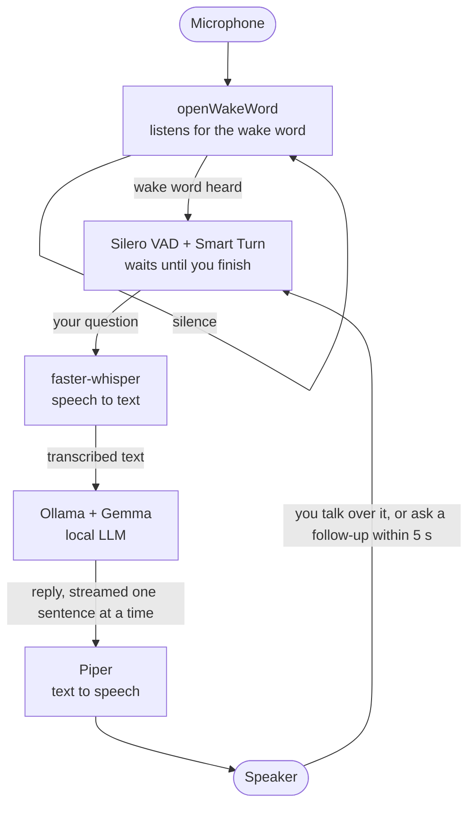

# NUC Offline Voice Assistant

[](https://github.com/DougieWilDaBeast/LocalChatbot/actions/workflows/ci.yml)

A fully offline voice assistant running on an Intel NUC with local LLM inference, wake word detection, speech-to-text, and text-to-speech. No cloud. No subscription. No data leaving the device: `setup.sh` downloads every model once, and after that nothing needs the internet.

Designed as a local-first voice assistant template you can personalize after cloning.

A personal project by [Will Douglas](https://github.com/DougieWilDaBeast), built to see how far a fully local voice assistant can go on an ordinary mini PC.

---

## Hardware

| Component | Spec                            |
| --------- | ------------------------------- |
| Device    | Intel NUC 11th Gen              |
| CPU       | Intel Core i5-1135G7 @ 2.40GHz  |
| RAM       | 32GB                            |
| GPU       | Intel Iris Xe Graphics (80 EUs) |
| OS        | Ubuntu 24.04 LTS                |

---

## Software Stack

| Layer            | Tool                                                        | Purpose                             |
| ---------------- | ----------------------------------------------------------- | ----------------------------------- |
| Model Serving    | [Ollama](https://ollama.com)                                | Runs Gemma locally via REST API     |
| LLM              | Gemma 4 E4B (default) or Gemma 3 4B                         | Conversational intelligence         |
| Speech-to-Text   | [faster-whisper](https://github.com/SYSTRAN/faster-whisper) | Offline transcription (small model) |
| Wake Word        | [openWakeWord](https://github.com/dscripka/openWakeWord)    | Passive trigger detection           |
| Text-to-Speech   | [Piper TTS](https://github.com/OHF-Voice/piper1-gpl)        | Fast offline voice synthesis        |
| Voice Activity   | [Silero VAD](https://github.com/snakers4/silero-vad) (bundled with openWakeWord) | Hears when you start and stop talking |
| End of Turn      | [Smart Turn v3.2](https://huggingface.co/pipecat-ai/smart-turn-v3) | Tells a pause from a finished question |
| Orchestration    | Python 3.12                                                 | Pipeline glue                       |
| Auto-start       | systemd                                                     | Runs as a service on boot           |

---

## Architecture



Every step runs on the NUC itself. Replies are streamed to Piper a sentence at a time, so the assistant starts speaking before the LLM has finished thinking.

---

## Project Structure

```
LocalChatbot/
├── README.md
├── LICENSE                   # GPL-3.0
├── config.example.yaml       # Copy to config.yaml and personalize
├── config.yaml               # Local runtime config (do not commit private values)
├── requirements.txt
├── requirements-dev.txt      # pytest and ruff
├── assistant.py              # Entry point: python3 assistant.py
├── nuc_assistant/            # The assistant itself
│   ├── main.py               #   Main conversation loop and command-line options
│   ├── config.py             #   Loads config.yaml, fills defaults, checks values
│   ├── audio.py              #   Mic recording and speaker playback
│   ├── listen.py             #   Voice activity, end of turn (Smart Turn), barge-in
│   ├── wakeword.py           #   Wake word detection (openWakeWord)
│   ├── stt.py                #   Speech-to-text (faster-whisper)
│   ├── llm.py                #   Ollama chat, streamed sentence by sentence
│   └── tts.py                #   Text-to-speech (Piper)
├── setup.sh                  # Full environment setup
├── test_pipeline.sh          # Test each layer individually
├── tests/                    # Unit tests (no mic, speaker or models needed)
├── .github/workflows/ci.yml  # Lint and test on every push
├── models/                   # Piper voice and Smart Turn model (downloaded by setup.sh)
├── install_service.sh        # Install systemd service
├── nuc-assistant.service     # systemd template (install script fills local values)
└── HARDWARE.md               # Hardware notes and tuning guidance
```

---

## Quick Start

```bash
# 1. Clone the repo
git clone https://github.com/DougieWilDaBeast/LocalChatbot.git
cd LocalChatbot

# 2. Run the setup script (installs Ollama, the models and a Python venv,
#    and creates config.yaml from config.example.yaml)
./setup.sh

# 3. Edit your local config
nano config.yaml

# 4. Test each part of the pipeline
./test_pipeline.sh

# 5. Talk to it in the terminal (--no-wake-word: press Enter instead)
source venv/bin/activate && python3 assistant.py --debug

# 6. Start it as a service on boot
sudo ./install_service.sh
```

Works on Ubuntu 24.04 Desktop or Server. The service runs as your user and talks to your PipeWire sound server; `install_service.sh` turns on lingering (`loginctl enable-linger`) so that sound server also starts at boot without anyone logging in.

## First-Clone Personalization Checklist

After cloning, update these values in `config.yaml`:

- `assistant.name`, and the same name in the first line of `assistant.system_prompt`. To answer to a different name, also pick a matching `wake_word.model` (built in: `hey_jarvis`, `alexa`, `hey_mycroft`, `hey_rhasspy`)
- `assistant.system_prompt`: optionally add a line about who the assistant is talking to (an example is in the comments above it)
- `audio.input_device` and `audio.output_device` (if defaults are not correct)
- `model.name` (optional if you want a different local Ollama model)

---

## Model Selection

| Model          | Ollama tag   | Download | Recommended For          |
| -------------- | ------------ | -------- | ------------------------ |
| Gemma 3 1B Q4  | `gemma3:1b`  | 0.8 GB   | Very low-spec hardware   |
| Gemma 3 4B Q4  | `gemma3:4b`  | 3.3 GB   | Lighter, faster replies  |
| Gemma 4 E4B Q4 | `gemma4:e4b` | 6.6 GB   | **This build (default)** |

Gemma 4 E4B takes about 7.5 GB of RAM once loaded, so with 32 GB the NUC runs any of them with plenty of headroom. On CPU it generates roughly 3 tokens (2 to 3 words) a second, which is why replies are streamed and spoken a sentence at a time (see [HARDWARE.md](HARDWARE.md) for measurements). Change `model.name` in `config.yaml` and `ollama pull` the model to switch.

---

## Intel GPU Acceleration

Everything currently runs on the CPU. The i5-1135G7's Iris Xe iGPU can be used for acceleration, and this is on the roadmap: Ollama's Vulkan backend for the LLM, and OpenVINO GenAI for Whisper (faster-whisper itself has no Intel GPU backend). See [HARDWARE.md](HARDWARE.md) for notes.

---

## Conversation: barge-in, end of turn and follow-ups

The assistant listens while it talks. If you speak over it for about 300 ms it stops mid-sentence, cancels the rest of the reply, and treats what you said as your next question. It decides you've finished speaking with the Smart Turn model, so a short pause mid-sentence doesn't cut you off. It also keeps listening while it transcribes, so if it decided too early and you carry on talking, the rest joins the same question. After each reply it keeps listening for 5 seconds so a follow-up doesn't need the wake word. All of this is under `conversation:` in `config.yaml`.

Barge-in needs the microphone not to hear the assistant's own voice. With a headset or a speakerphone that cancels echo, nothing else is needed. With a separate speaker and mic, turn on echo cancellation in PipeWire (Ubuntu 24.04's sound server), then make the new echo-cancelled microphone the default input:

```bash
mkdir -p ~/.config/pipewire/pipewire.conf.d
cat > ~/.config/pipewire/pipewire.conf.d/echo-cancel.conf <<'CONF'
context.modules = [
  { name = libpipewire-module-echo-cancel
    args = { library.name = aec/libspa-aec-webrtc } }
]
CONF
systemctl --user restart pipewire pipewire-pulse
pactl list short sources               # find the echo-cancel source's name
pactl set-default-source <echo-cancel source name>
```

If the assistant still interrupts itself, set `conversation.barge_in: false`.

---

## How it works, and why

- **Streaming replies.** On a laptop-class CPU the LLM writes a few words a second, so waiting for a whole reply would mean long silences. `llm.py` reads Ollama's stream and hands each finished sentence to Piper while a background thread keeps generating; the first sentence is spoken after a few seconds. Long sentences are split at commas, and markdown, emoji and links are stripped before Piper reads them.
- **Thinking off, model kept loaded.** Gemma 4 reasons before answering by default, which made replies about ten times slower, so `think: false` is sent. `keep_alive: -1` keeps the model in memory between questions, and it is loaded at startup.
- **Voice activity and end of turn.** Silero VAD (shipped inside openWakeWord) hears when speech starts. A fixed silence timer either cuts people off mid-thought or feels slow, so when you pause, the Smart Turn model decides from the audio whether you've finished.
- **Barge-in.** A second VAD instance listens in a background thread while the reply plays; 300 ms of speech stops playback, cancels the Ollama request, and the audio already heard becomes the start of your next question. Only the part of the reply you heard goes into the conversation memory.
- **Failing loudly.** If Ollama fails mid-conversation the assistant says so instead of going quiet; missing models stop it at startup with a fix-it message; repeated audio errors make it exit so systemd restarts it.
- **Why not a full-duplex model?** See [Future Work](#future-work).

---

## Troubleshooting

| Symptom | Check |
| ------- | ----- |
| No sound, or "Error querying device" | `./test_pipeline.sh` lists the devices; set `audio.input_device` / `audio.output_device` |
| Something's wrong with the service | `journalctl -u nuc-assistant -p warning` shows just the warnings and errors; `-f` follows the live log |
| It keeps interrupting itself | The mic hears the speaker: set up echo cancellation (above), use a headset, or set `conversation.barge_in: false` |
| "Model ... isn't downloaded" | `ollama pull gemma4:e4b` (or whatever `model.name` says) |
| It cuts you off, or waits too long | `conversation.pause_ms` and `max_pause_ms` |
| Wake word too sensitive / deaf | `wake_word.threshold` (lower = more sensitive) |

---

## Customisation

The system prompt is configured in `config.yaml` (created from `config.example.yaml`). Edit it to personalize the assistant for whoever is using it: their name, location, interests, and preferred response style.

---

## Development

About 90 unit tests fake the microphone, speaker, Ollama and the speech models, so they run on any machine in a few seconds:

```bash
source venv/bin/activate
pip install -r requirements-dev.txt
ruff check .
pytest
```

GitHub Actions runs the same checks on every push and pull request.

---

## Roadmap

- [x] Base pipeline (STT → LLM → TTS)
- [x] Wake word detection
- [x] systemd auto-start
- [x] Conversation memory (rolling context window)
- [x] Stream LLM replies to TTS sentence by sentence
- [x] Barge-in: talk over the assistant to stop it
- [x] Smart Turn end-of-turn detection
- [x] Follow-up window without the wake word
- [x] Keep listening while transcribing, so a pause doesn't split a question
- [ ] Demo video and latency measurements on the NUC
- [ ] Intel Iris Xe LLM offload via Ollama's Vulkan backend
- [ ] OpenVINO GenAI Whisper inference on the iGPU
- [ ] Physical button trigger (GPIO or USB)
- [ ] 3D printed case (Bambu Lab X1 Carbon)
- [ ] Web UI for config editing

---

## Future Work

### Full-duplex voice models (needs stronger hardware)

Full-duplex speech-to-speech models listen and talk at the same time, so they can be interrupted, make "mm-hm" sounds while you speak, and reply in a few hundred milliseconds. As of October 2026 the open options are Kyutai's [Moshi](https://github.com/kyutai-labs/moshi), NVIDIA's [PersonaPlex-7B](https://huggingface.co/nvidia/personaplex-7b-v1) (built on Moshi), [MiniCPM-o 4.5](https://github.com/tc-mb/llama.cpp-omni) through the llama.cpp-omni fork, and NVIDIA's NemotronLabs VoiceChat ([paper](https://arxiv.org/abs/2609.21967)).

None of them is practical on the NUC. They are 7B to 9B models that target CUDA or Apple Metal, and none supports Intel GPUs. Moshi runs its 7B model about 12.5 times a second without pause, while the i5-1135G7 manages a few tokens a second on the smaller Gemma 4 E4B, so it would run at least 4x slower than real time.

So the existing pipeline was made more conversational instead: streaming replies, barge-in (talking over the assistant to stop it), Smart Turn end-of-turn detection, and a short follow-up window without the wake word (see [Conversation](#conversation-barge-in-end-of-turn-and-follow-ups)). Revisit full-duplex if the assistant moves to a machine with an NVIDIA GPU with 16 GB or more of VRAM, or if a small full-duplex model with a CPU or Vulkan runtime appears.

Other things worth testing later:

- [LFM2.5-Audio-1.5B](https://huggingface.co/LiquidAI/LFM2.5-Audio-1.5B): a small turn-based speech-to-speech model with CPU GGUF builds, as an experimental mode.
- [Kyutai Pocket TTS](https://kyutai.org/tts/): a 100M-parameter streaming TTS that runs in real time on a CPU, as a more natural alternative to Piper.
- Gemma 4's own audio input, which could replace faster-whisper and save loading one model.

---

## License

GPL-3.0. See [LICENSE](LICENSE). This matches [Piper TTS](https://github.com/OHF-Voice/piper1-gpl), which is also GPL-3.0.

The models are downloaded by `setup.sh`, not shipped here, and have their own licences:

| Model | Licence |
| ----- | ------- |
| Gemma 4 E4B | [Gemma terms of use](https://ai.google.dev/gemma/terms) |
| Whisper (faster-whisper conversion) | MIT |
| Piper voice en_GB-alba-medium | See the voice's model card on [Hugging Face](https://huggingface.co/rhasspy/piper-voices) |
| openWakeWord pre-trained models (hey_jarvis etc.) | CC BY-NC-SA 4.0 (non-commercial) |
| Silero VAD | MIT |
| Smart Turn v3.2 | BSD-2-Clause |
